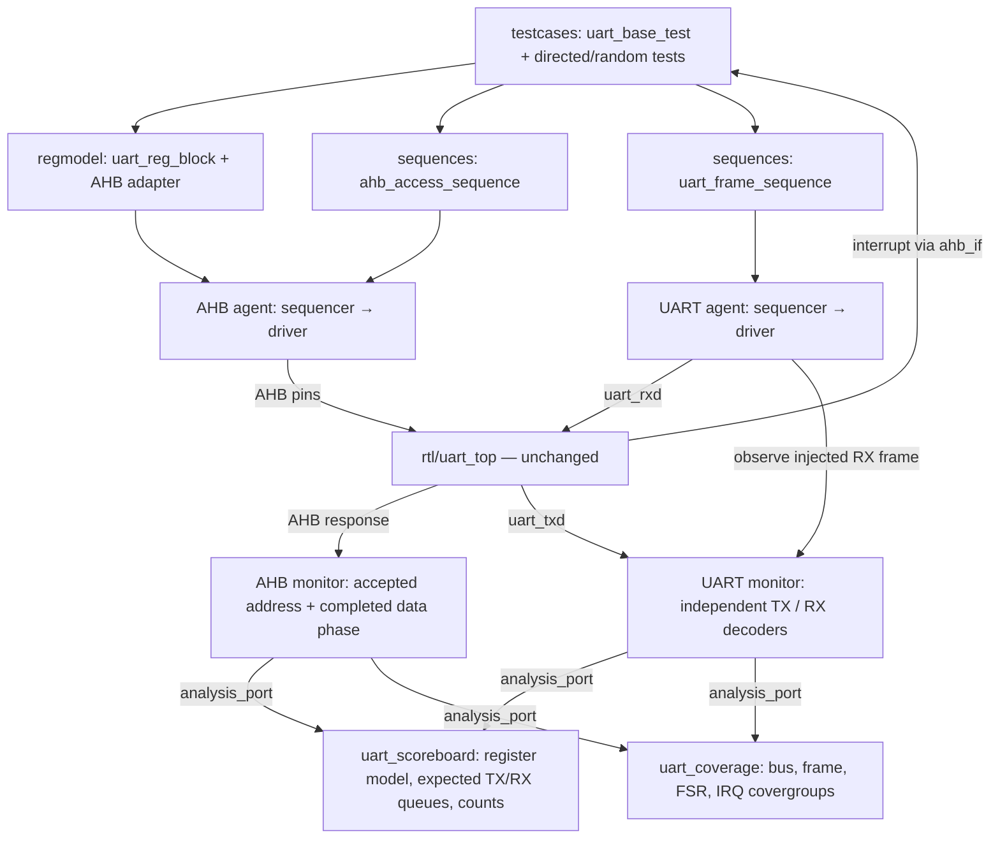

# UART IP verification bằng UVM

Bài tập Session 19–24, đối chiếu **UART IP Specification Version 2.0**.
Môi trường gồm AHB-Lite master VIP, UART VIP hai chiều, UVM RAL, scoreboard,
functional coverage và regression QuestaSim. Toàn bộ `rtl/` được giữ nguyên.

Có **ba lỗi RTL còn OPEN**: parity TX, báo lỗi parity RX và nhận frame liên tiếp ở 13x/divisor 2. Test tái hiện lỗi phải trả về FAIL;
không sửa RTL và không hạ severity để làm xanh regression.
Kết quả thực tế nằm trong [Vplan.xlsx](Vplan.xlsx), [VPLAN.md](docs/VPLAN.md),
[bug report](docs/BUG_REPORT.md) và [báo cáo kiểm chứng](docs/VERIFICATION_REPORT.md).

## Chạy mô phỏng

Cần QuestaSim có license, thư viện UVM 1.2 đi kèm, GCC tương thích máy hiện tại,
Python 3, GNU Make và Perl. Đã chạy với QuestaSim 2021.2_1, HCLK 100 MHz.
Đưa `vlog`, `vsim`, `vlib`, `vmap`, `vcover` lên PATH. Không cần sửa script theo
đường dẫn máy; có thể override `QUESTA_HOME` và `UVM_HOME` khi cần.

```bash
make -C sim all TESTNAME=uart_smoke_test SEED=1 COV=ON
make -C sim run TESTNAME=uart_rx_format_test SEED=1 COV=ON
./sim/regress.pl --seed 1
make -C sim cov_merge cov_report
python3 sim/test_runner.py
sha256sum -c docs/rtl.sha256
```

Regression đầy đủ cố ý trả mã khác 0 khi tái hiện lỗi RTL. `regress.json` và
`regress.rpt` ghi rõ từng seed, exit code, timeout và log; `./sim/regress.pl -r`
tạo lại báo cáo từ đúng manifest. Lượt chưa hoàn tất được báo UNKNOWN.

Mỗi test có `sim/log/<test>_<seed>.log`, `.wlf`, `.ucdb`. Mở waveform:

```bash
make -C sim wave TESTNAME=uart_tx_parity_bug_test SEED=1
```

Test baud bao gồm divisor 65535 ở cả hai hướng nên mô phỏng khoảng 493 ms
(thời gian mô phỏng), chạy lâu hơn các test khác. Timeout host là 240 giây/mỗi
run; deadline mô phỏng mặc định 500000 us, override bằng
`RUNARG=+TIMEOUT_US=1000000` khi mở rộng testcase.

## Cấu trúc và kết nối



- `vip/`: hành vi giao thức tái sử dụng, active/passive agents, configuration,
  sequencer, driver, monitor; interface được compile ngoài package.
- `regmodel/register/`, `regmodel/`: trường thanh ghi theo spec và adapter AHB.
- `sequences/`: một giao dịch bus hoặc một frame UART.
- `tb/`: DUT hookup, scoreboard, coverage và catcher chỉ dành cho self-test.
- `testcases/`: 29 testcase thuộc 9 group; mỗi UVM class một file.
- `sim/`: file list, Makefile, regression, giải mã VCD độc lập và sinh vplan.
- `docs/`: vplan có thể diff, bug report, kế hoạch và bằng chứng đã lưu.

Scoreboard lấy dữ liệu kỳ vọng từ giao dịch bus/stimulus, không lấy từ output
DUT. Test FIFO chủ động khai báo các ghi bị loại sau khi nạp đủ FIFO, rồi kiểm
tra số lượng/thứ tự frame thực tế. TX FIFO có 16 entry và một byte đã được
prefetch vào thanh ghi dịch; testcase kiểm tra được cả trạng thái BGE bật/tắt.

Test frame độc lập thực hiện reset trước mỗi cấu hình theo trình tự khởi tạo
ở Chapter 3. Thay divisor trực tiếp khi UART đang hoạt động không thuộc cam kết
kiểm chứng của bộ này. Không xác định giá trị RBR khi FIFO rỗng, divisor 0,
AHB size/burst không hỗ trợ, lỗi stop bit hoặc RX overflow vì spec không định
nghĩa đầy đủ kết quả các trường hợp đó.

## Cập nhật tài liệu kết quả

`docs/vplan.json` là danh mục yêu cầu/test/checker. Sau regression hoàn chỉnh,
lưu manifest và coverage đã đọc vào `docs/results/`, rồi chạy:

```bash
python3 sim/update_vplan.py
```

Script tạo `Vplan.xlsx` (Summary, Vplan, Bugs, Coverage), `docs/Vplan.csv` và
`docs/VPLAN.md` bằng thư viện chuẩn Python. Nó từ chối manifest chưa hoàn tất
hoặc danh mục testcase không khớp. Coverage chỉ merge những UCDB nằm trong
manifest của lượt hiện tại; các lần chạy FAIL vẫn được ghi nhận đã thực thi,
nhưng không được coi là đạt chức năng theo spec.
